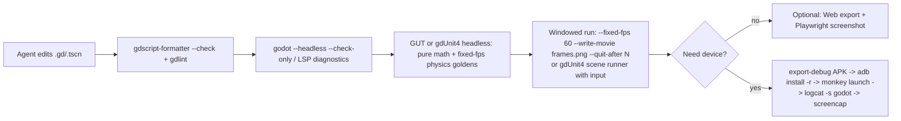

# Godot 4.x agent build-and-verify loop: what's achievable

Research date: 2026-10-19. Engine baseline: Godot 4.7 (what `project.godot` targets,
`config/features=PackedStringArray("4.7", "GL Compatibility")`). Doc links point at the
`stable` docs, which are labelled 4.7 at time of writing.

Question: what is the best AI-agent build-and-verify loop we can get for Vector Thrust
(2D, portrait, Android, GDScript, `CharacterBody2D` vehicle in `scripts/vehicle.gd`)
if we stay on Godot, and where does it still fall short of a Vite/Vitest/Playwright web loop?

Claims are cited inline. Lines marked **(inference)** are my reasoning from the cited
facts, not something a source says directly.

---

## TL;DR

- **Logic tests run headless and are solid.** GUT and gdUnit4 both support Godot 4.7,
  have CLI runners with exit codes, and write JUnit XML. Physics runs headless; with
  `--fixed-fps` the frame delta is decoupled from wall-clock time.
- **Pixels and input do not work headless.** `--headless` turns off all rendering, and
  gdUnit4's own runner refuses to run headless by default because InputEvents aren't
  delivered. For screenshots, or for tests that inject input, run a normal windowed
  (GPU) process: `--write-movie` to a PNG sequence, or `Viewport.get_texture().get_image()`.
  On a Windows dev box this is fine. On Linux CI you need a virtual display.
- **Static checks are partial.** `gdtoolkit` (gdlint/gdformat) and GDQuest's Rust
  `gdscript-formatter` work from the CLI but only parse, they don't type-check.
  Real type and API errors come from Godot itself (`--check-only`, or the LSP, which
  needs a running Godot instance).
- **There are many MCP servers.** Several community servers (none official) let an agent
  run the game, read logs, inject input, step time and take screenshots. The best of them
  get close to "Playwright for Godot", but they are young, single-maintainer projects.
- **Android loop:** CLI export, then `adb install -r`, launch, `logcat`, and `screencap`.
  All of it is scriptable. The editor's one-click deploy plus "Synchronize Script Changes"
  gives a live-reload-ish loop on device, but only from the editor.
- **Web export works as a preview target** (Compatibility renderer, which we already use).
  It lets us reuse Playwright against the Godot build, but the agent only sees a `<canvas>`,
  with no DOM to assert on.

---

## 1. Headless unit and integration tests

### GUT (bitwes/Gut)
- Version 9.7.1 targets Godot 4.7.x ([README compat table](https://github.com/bitwes/Gut)).
  The latest GitHub release is v9.7.1, published 2026-07-10 (`gh api repos/bitwes/Gut/releases`).
- Features include doubles, partial doubles, stubs, spies and JUnit XML export
  ([README](https://github.com/bitwes/Gut)).
- CLI: `godot -d -s --path "$PWD" addons/gut/gut_cmdln.gd -gdir=res://test -gexit -gjunit_xml_file=...`.
  It exits 0 if all tests pass and 1 if any fail ([GUT CLI docs](https://gut.readthedocs.io/en/latest/Command-Line.html)).
  Those docs don't mention `--headless`, but GUT tests that don't need input or pixels
  have no reason to need a display. **(inference)**
- `simulate(obj, times, delta)` calls `_process` and `_physics_process` directly. Per its
  docs, timers "will not fire since the main loop of the game is not actually running"
  ([GUT Simulate](https://gut.readthedocs.io/en/latest/Simulate.html)).
  **(inference)** For our `CharacterBody2D`, `simulate` drives `_physics_process`, but
  `move_and_slide()` still queries the physics space. Collision-dependent tests should
  `await` real physics frames in the scene tree, not rely on `simulate`.

### gdUnit4 (godot-gdunit-labs/gdUnit4)
- v6.2.x supports Godot 4.5 to 4.7.1. Master (v7.0.0) targets 4.7 and 4.8.dev
  ([README](https://github.com/godot-gdunit-labs/gdUnit4)). The latest release is v6.2.2,
  published 2026-10-07 (`gh api .../releases/latest`).
- It has a Scene Runner that simulates mouse, keyboard, touch and input actions, can
  `simulate_frames(frames, delta_ms)` and `set_time_factor`, and can wait for signals
  or function results ([scene runner docs](https://godot-gdunit-labs.github.io/gdUnit4/latest/advanced_testing/sceneRunner/)).
- CLI: `addons/gdUnit4/runtest -a res://test` (with `GODOT_BIN` set). Exit codes are
  0 for success, 100 for failures, 101 for warnings. It writes an HTML `index.htm` and a
  JUnit `results.xml` to `reports/` ([cmd docs](https://godot-gdunit-labs.github.io/gdUnit4/latest/advanced_testing/cmd/)).
  There is also a GitHub Action, [gdUnit4-action](https://github.com/godot-gdunit-labs/gdUnit4-action).
- **Headless caveat, from the runner source:** by default it errors out with
  "Headless mode is not supported! ... Godot 'InputEvents' are not transported by the
  Godot engine in headless mode and therefore have no effect in the test!". You can pass
  `--ignoreHeadlessMode` to run anyway
  ([GdUnitTestCIRunner.gd](https://github.com/godot-gdunit-labs/gdUnit4/blob/master/addons/gdUnit4/src/core/runners/GdUnitTestCIRunner.gd)).
  So input-driven tests need a windowed process.

### Running physics deterministically headless
- `--headless` is `--display-driver headless --audio-driver Dummy` ([CLI docs](https://docs.godotengine.org/en/stable/tutorials/editor/command_line_tutorial.html)).
  It exists for dedicated servers, which run game logic without a GPU
  ([dedicated server docs](https://docs.godotengine.org/en/stable/tutorials/export/exporting_for_dedicated_servers.html)).
  So physics and `_physics_process` do run.
- `--fixed-fps <n>` "Force[s] a fixed number of frames per second. This setting disables
  real-time synchronization." `--quit-after <n>` stops after N iterations, and
  `--time-scale` changes the game speed ([CLI docs](https://docs.godotengine.org/en/stable/tutorials/editor/command_line_tutorial.html)).
- `Engine.physics_ticks_per_second` is the fixed physics rate. `physics_jitter_fix`
  controls how closely ticks follow real time ([Engine docs](https://docs.godotengine.org/en/stable/classes/class_engine.html)).
- **(inference)** Setting `--fixed-fps` equal to `physics_ticks_per_second` (e.g. 60/60)
  gives one physics step per frame no matter how fast the host is. Runs should then
  reproduce on the same binary and machine, which is good enough for golden-trajectory
  regression tests of `vehicle.gd`. I found no official guarantee of bit-exact determinism
  across platforms or CPUs; the Engine docs don't mention determinism at all. Jolt (built
  in since 4.4) is 3D-only and experimental ([4.4 release notes](https://godotengine.org/releases/4.4/)).
  Cross-platform-deterministic 2D physics exists only as a third-party option, e.g. the
  Rapier 2D "Cross Platform Deterministic" build in the
  [Asset Library](https://godotengine.org/asset-library/asset/edit/11688).
- **(inference)** The cheapest deterministic tests don't use the engine loop at all. Pull
  the pure math out of `vehicle.gd` (`_desired_rotation`, the thrust and gravity integration)
  into static functions and unit-test those directly with GUT or gdUnit4.

## 2. Getting frames an LLM can see

- **Headless can't render.** The RenderingServer docs say: "Starting the engine with the
  --headless command line argument disables all rendering and window management
  functions" ([RenderingServer](https://docs.godotengine.org/en/stable/classes/class_renderingserver.html)).
  Users report `get_image()` returning null under headless
  ([Godot Q&A](https://ask.godotengine.org/150510/godot-headless-not-same-godot-window-cant-render-the-backend)).
- **Movie Maker** (`--write-movie out.png` or `.avi`; OGV only in editor builds) records
  in non-real time with "perfect frame pacing". Use it with `--fixed-fps`, `--resolution`
  and `--quit-after N` ([Movie Maker docs](https://docs.godotengine.org/en/stable/tutorials/animation/creating_movies.html)).
  A PNG-sequence target gives numbered frames that an agent can Read directly. The docs
  don't say whether it works headless. Given the RenderingServer note, assume it needs
  a real renderer. **(inference)**
- **Viewport capture from script:** `await RenderingServer.frame_post_draw`, then
  `get_viewport().get_texture().get_image().save_png(...)`. The texture "might be completely
  black or outdated if used too early" ([Viewport docs](https://docs.godotengine.org/en/stable/classes/class_viewport.html)).
- **Recipe (inference):** a debug-only autoload reads custom args such as
  `--shot-at=120,240` (frame numbers) and a scripted input timeline, saves PNGs, and calls
  `get_tree().quit()`. Run it windowed with `--fixed-fps 60` so the captured frames are
  reproducible. On Linux CI this needs Xvfb or similar, because a GPU-less runner can't
  render.

## 3. Scripted input injection

- `Input.parse_input_event(ev)` "Feeds an InputEvent to the game". `Input.action_press`
  simulates an action, with an optional strength. `emulate_touch_from_mouse` and
  `emulate_mouse_from_touch` exist as project settings ([Input docs](https://docs.godotengine.org/en/stable/classes/class_input.html)).
- `scripts/main.gd` handles both `InputEventMouseButton` and `InputEventScreenTouch` in
  `_unhandled_input`, so a synthetic `InputEventScreenTouch` replays "tap-to-target"
  faithfully. **(inference)**
- Per gdUnit4 (section 1), injected events have no effect under `--headless`, so input
  replay is a windowed-only feature. Setting state directly (`vehicle.set_navigator_target()`,
  `set_thrust_button_held()`) does work headless and is the more robust test seam.
  **(inference)**
- On a physical device: `adb shell input` is not documented on the main adb page. Screen
  capture is (`adb exec-out screencap -p > screen.png`, `adb shell screenrecord`)
  ([adb docs](https://developer.android.com/tools/adb)).

## 4. Static checks: LSP, lint, format from the CLI

- **gdtoolkit** (`pip install "gdtoolkit==4.*"`) provides `gdlint`, `gdformat`, `gdparse`
  and a complexity metric (`gdradon`). The README warns that "Formatting may lead to data loss"
  ([README](https://github.com/Scony/godot-gdscript-toolkit)). The latest release is 4.5.0,
  from 2025-10-09, so it may lag the newest 4.5+ syntax such as variadic arguments and
  `@abstract`. **(inference)**
- **GDQuest GDScript-formatter** is written in Rust (GitHub repo language). It has `--check` (exits 1 if the file needs formatting), `--safe` (refuses to
  write if formatting would change behaviour), and a `lint` subcommand. Formatting takes
  "up to a few milliseconds" ([GDQuest page](https://gdquest.com/library/gdscript_formatter/),
  [repo](https://github.com/GDQuest/GDScript-formatter)). The latest release is 0.27.0,
  from 2026-09-25. Godot itself has no built-in formatter: a merged-PR search on
  godotengine/godot for "GDScript formatter" returns nothing relevant.
- **Neither tool type-checks.** For real errors:
  - `godot --headless --check-only -s <script>` will "Only parse for errors and quit"
    ([CLI docs](https://docs.godotengine.org/en/stable/tutorials/editor/command_line_tutorial.html)).
    It is per script. I didn't verify a one-shot whole-project equivalent; `--import`
    loads the project and is the usual CI warm-up.
  - **LSP:** Godot ships a GDScript language server (default port 6005; DAP on 6006),
    but "a Godot instance must be running on your current project"
    ([external editor docs](https://docs.godotengine.org/en/stable/tutorials/editor/external_editor.html)).
    `--lsp-port` and `--dap-port` are CLI flags. JetBrains Rider can "automatically start
    [a] headless LSP server" when the editor isn't open
    ([Rider docs](https://jetbrains.com/help/rider/2024.2/Settings_Godot_Engine.html)).
    So an agent can run `godot --editor --headless --path . --lsp-port 6005` in the
    background, then connect over TCP. **(inference; not shown in Godot's own docs)**
  - Turn on typed-GDScript warnings-as-errors in project settings, so `--check-only` and
    the LSP catch more mistakes. **(inference)**

## 5. How well do LLMs know Godot 4.x?

There is no primary-source benchmark for this, so treat this section as judgment
grounded in documented API churn.

- The 3 to 4 break was large. Classes were renamed (`KinematicBody2D` became
  `CharacterBody2D`, `Spatial` became `Node3D`, `VisualServer` became `RenderingServer`),
  as were methods (`update()` became `queue_redraw()`, `empty()` became `is_empty()`).
  Some semantics changed silently: `Camera2D.zoom` is inverted, and `Array.slice` now
  excludes its end index. The official converter leaves "a large part of the upgrade
  process" manual ([upgrade guide](https://docs.godotengine.org/en/stable/tutorials/migrating/upgrading_to_godot_4.html)).
  Years of Godot 3 tutorials in training data make Godot 3 drift the main failure mode:
  `yield`, `export var`, `onready`, string `connect`, `move_and_slide(velocity)`.
- 4.x keeps moving. 4.4 added typed dictionaries and `.uid` sidecar files
  ([4.4 notes](https://godotengine.org/releases/4.4/)); this repo already has
  `scripts/*.gd.uid`. 4.5 added variadic functions, abstract classes and script backtracing
  ([4.5 notes](https://godotengine.org/releases/4.5/)). Models are least reliable on the
  newest features.
- Mitigations:
  - `godot --doctool <dir>` dumps the exact engine API as XML, and `--dump-extension-api`
    dumps it as JSON ([CLI docs](https://docs.godotengine.org/en/stable/tutorials/editor/command_line_tutorial.html)).
    Commit or cache one per engine version so the agent can grep ground truth.
  - `--check-only` and the LSP catch hallucinated APIs quickly.
  - Some MCP servers (below) serve version-matched docs.
- Scene files (`.tscn`) and `project.godot` are text but use engine-specific
  encodings, and mistakes in them can fail silently. This repo's
  `design/godot-gotchas.md` records two such cases: an orientation string silently
  parsing to 0, and a stretch-mode mismatch. An LLM won't reliably know these.
  **(inference, grounded in our own notes)**

## 6. Faster Android deploy loop

- **Editor one-click deploy:** with a Runnable Android preset and a device visible in
  `adb devices` (USB or Wi-Fi via `adb pair`), the editor exports, installs and runs in
  debug mode ([one-click deploy](https://docs.godotengine.org/en/stable/tutorials/export/one-click_deploy.html)).
  Our `export_presets.cfg` already has `runnable=true`.
- **Debug menu options** ([debugging tools](https://docs.godotengine.org/en/stable/tutorials/scripting/debug/overview_of_debugging_tools.html)):
  - "Deploy with Remote Debug": intended "typically with a mobile device".
  - "Small Deploy with Network Filesystem": "builds a minimal executable"; on Android it
    deploys over USB.
  - "Synchronize Scene Changes" and "Synchronize Script Changes": editor changes are
    "replicated" or "reloaded in the running project".
  - The Remote scene tree lets you inspect and change node properties live.

  This is the closest thing to live reload on device. It is editor-driven, though:
  whether it picks up files an agent edits on disk depends on the editor reloading them.
  **(unverified)**
- **Agent-scriptable CLI loop (inference, assembled from cited pieces):**
  ```sh
  godot --headless --path . --export-debug "Android" builds/android/vector-thrust.apk
  adb install -r builds/android/vector-thrust.apk
  adb shell monkey -p com.sqrt57.vectorthrust -c android.intent.category.LAUNCHER 1
  adb logcat -s godot:V            # Godot logs under tag "godot"
  adb exec-out screencap -p > shot.png
  ```
  Sources for each piece:
  - `--export-debug` implies `--import` ([CLI docs](https://docs.godotengine.org/en/stable/tutorials/editor/command_line_tutorial.html)).
  - `pm install -r` reinstalls keeping data, and `screencap`, `am start` and wireless
    pairing are documented ([adb docs](https://developer.android.com/tools/adb)).
  - The logcat tag filter syntax is in the [logcat docs](https://developer.android.com/tools/logcat).
  - The tag `"godot"` comes from `__android_log_vprint(..., "godot", ...)` in
    [`platform/android/os_android.cpp`](https://github.com/godotengine/godot/blob/master/platform/android/os_android.cpp).
  - Signing via the `GODOT_ANDROID_KEYSTORE_DEBUG_*` env vars is in the
    [Android export docs](https://docs.godotengine.org/en/stable/tutorials/export/exporting_for_android.html).
  - Our preset has `gradle_build/use_gradle_build=false`, so exports skip Gradle and stay
    fast. AAB output needs Gradle (same doc).
- `--remote-debug tcp://host:6007` plus `--debug-server` exist for attaching a running
  game to an editor debug server ([CLI docs](https://docs.godotengine.org/en/stable/tutorials/editor/command_line_tutorial.html)).
  I didn't verify scripting an on-device remote-debug session without the editor.

## 7. Godot MCP servers and agent tooling

None are official. The most notable, from `gh search repos "godot mcp"` on 2026-10-19:

| Repo | Stars | Last push | What it gives an agent |
|---|---|---|---|
| [Coding-Solo/godot-mcp](https://github.com/Coding-Solo/godot-mcp) | ~6.2k | 2026-04-16 | Launch editor, run project, capture debug output, scene ops, UID mgmt. `claude mcp add godot -e GODOT_PATH=... -- npx @coding-solo/godot-mcp`. No screenshots or input in README. |
| [satelliteoflove/godot-mcp](https://github.com/satelliteoflove/godot-mcp) | ~180 | 2026-10-02 | Godot 4.5+, MIT. Editor addon bridge. Freeze, step and step-until on the game clock ("deterministic playtesting"), input injection (actions, keys, mouse), live runtime state as JSON, in-game GDScript exec, game and editor screenshots, version-matched docs, profiler. Read and write tools are split for permission gating. |
| [tugcantopaloglu/godot-mcp](https://github.com/tugcantopaloglu/godot-mcp) | ~490 | 2026-10-09 | Claims 157 tools, "Tested with Godot 4.7". |
| [youichi-uda/godot-mcp-pro](https://github.com/youichi-uda/godot-mcp-pro) | ~630 | 2026-09-24 | Paid ($15). Claims input simulation and runtime analysis. |
| [wgt19861219/godot-mcp-enhanced](https://github.com/wgt19861219/godot-mcp-enhanced) | ~100 | 2026-10-14 | Headless, editor and game-bridge layers. Claims "recording & frame-verify". |

**(inference)** satelliteoflove's design is the best fit for the verify loop. State is
returned as JSON first, with screenshots only when needed, and it covers stepping, input
and exec. It depends on the editor GUI running with an addon installed in the project,
and it's a small, young project. I didn't test any of these servers. Star counts and
claims are as self-reported on GitHub.

## 8. Web export as a browser preview target

- Web export supports only the Compatibility renderer (WebGL 2.0), which matches our
  `gl_compatibility` setting. Single-threaded export has been the default since 4.3, so
  there's no COOP/COEP header dance. Chromium or Firefox are recommended over Safari.
  Web builds "run slower than native" on mobile. Godot 4 C# projects can't export to web
  ([web export docs](https://docs.godotengine.org/en/stable/tutorials/export/exporting_for_web.html)).
- The editor has a "Run in browser" button, and the docs provide `serve.py` for local
  serving. Debugging means browser devtools only (same doc).
- **(inference)** This is the most agent-friendly visual path: export Web from the CLI,
  serve it, and drive it with Playwright. Playwright gives screenshots, mouse and touch
  input, console logs and `page.clock` time control, which overrides `requestAnimationFrame`
  ([Playwright clock](https://playwright.dev/docs/clock)). It also works in headless
  Chromium on Linux CI with no Xvfb. The limits:
  - The game is one `<canvas>`, so assertions need `JavaScriptBridge` hooks or pixel checks.
  - Every change needs a full re-export; there's no HMR.
  - Behaviour differs from Android in performance, audio (Sample playback mode by default)
    and input.

## 9. Recommended Godot loop (if we stay)



Add an MCP bridge (satelliteoflove-style) for interactive sessions where the agent needs
to step time and read state in a live game.

## 10. Frank comparison: where Godot stays weaker than Vite/Vitest/Playwright

1. **Pixels need a real renderer.** Godot headless renders nothing (RenderingServer docs),
   so visual checks need a GPU window or Xvfb. Headless Chromium renders by default.
2. **No headless input.** Injected InputEvents are dropped under `--headless`
   (gdUnit4 source). Playwright's input works in headless browsers.
3. **Iteration latency.** Vite has HMR over native ESM ([Vite features](https://vite.dev/guide/features)).
   Godot's nearest equivalent ("Synchronize Script Changes") is tied to the editor GUI.
   CLI runs pay full engine start and project load every time. **(inference on cost;
   not benchmarked)**
4. **Static analysis.** TypeScript plus `tsc` gives project-wide type errors from a plain
   CLI. GDScript's type checker lives inside the engine (`--check-only` per script, or an
   LSP that needs a running Godot instance), and the third-party formatters and linters
   only parse. Note that Vite itself "does NOT perform type checking", so the web loop
   also needs `tsc` alongside it (Vite docs).
5. **Model fluency.** TS and web APIs are stable and heavily represented in training data.
   Godot carries the 3 to 4 drift plus per-minor-release additions (sections 5 and 8).
6. **Observability.** A web DOM is inspectable and assertable. A Godot game is opaque
   unless you build hooks: runtime-state dumps, an MCP bridge, or `JavaScriptBridge` on web.
7. **Tooling maturity.** Playwright and Vitest are first-party and broadly maintained.
   Godot's agent tooling (MCP servers, gdUnit4's input layer) is community-run, and the
   most capable options are small projects.
8. **Where Godot is equal or better:**
   - Fixed-timestep, non-real-time capture (`--fixed-fps` + Movie Maker) is built in.
     Browsers need `page.clock` and care to get the same.
   - Android export is native, not a WebView or wrapper.
   - Physics, input mapping, touch emulation and stretch/letterboxing come out of the box.
   - The device loop (one-click deploy, remote scene tree) has no web-stack equivalent
     short of Capacitor plus Chrome remote devtools. **(inference)**

**Bottom line (inference):** a Godot loop can be made good. It gets headless logic and
physics tests, windowed deterministic screenshots, a scripted adb loop and MCP-driven
playtesting. But each of those is something we'd assemble and maintain ourselves, where
the web stack mostly provides them already. The gap that stays is headless visuals and
input, plus the editor-bound live reload.
